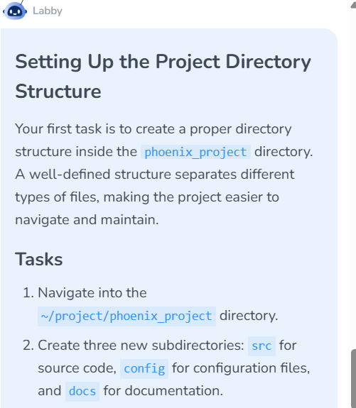
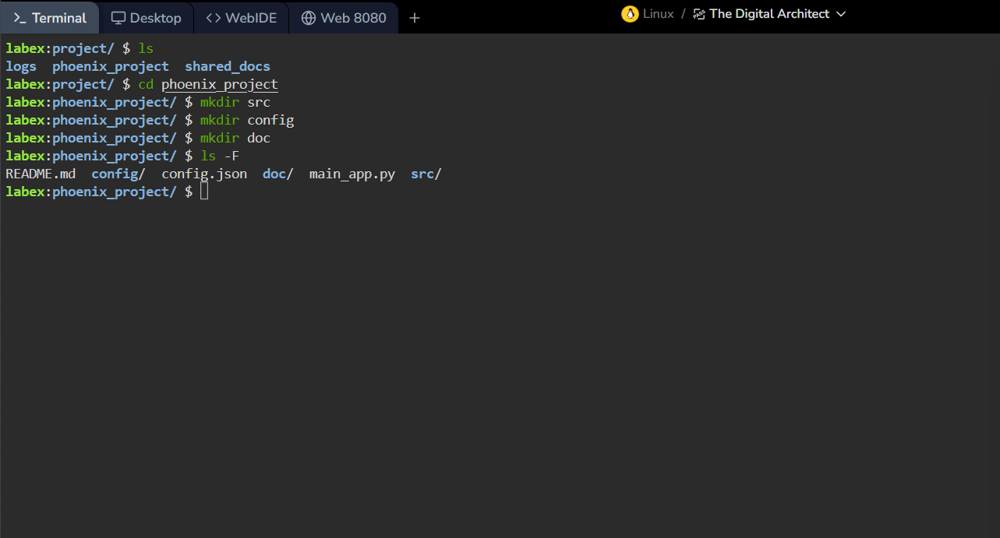
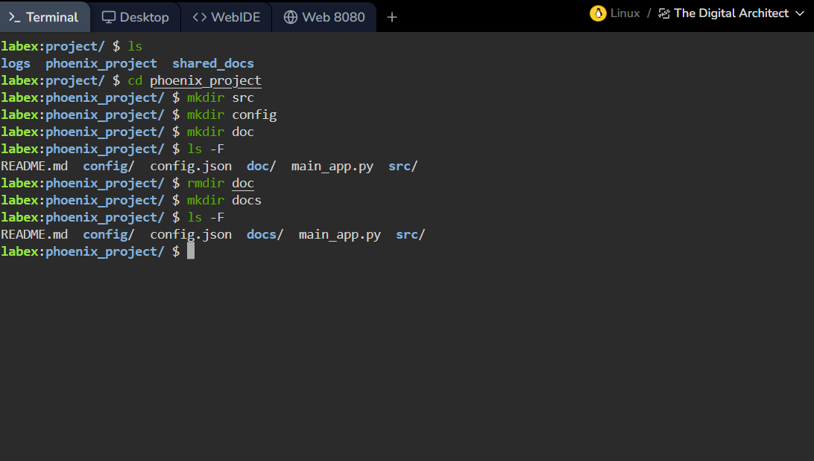
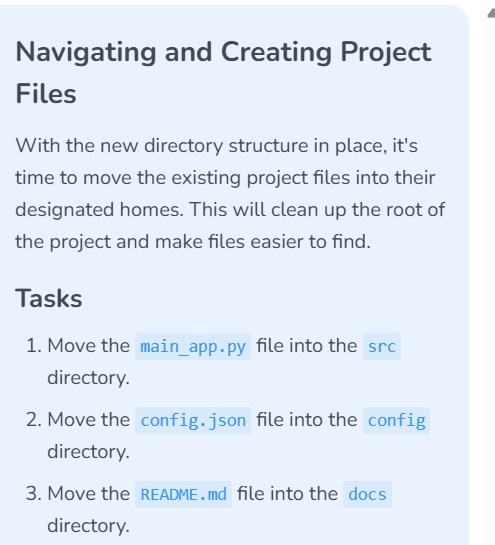
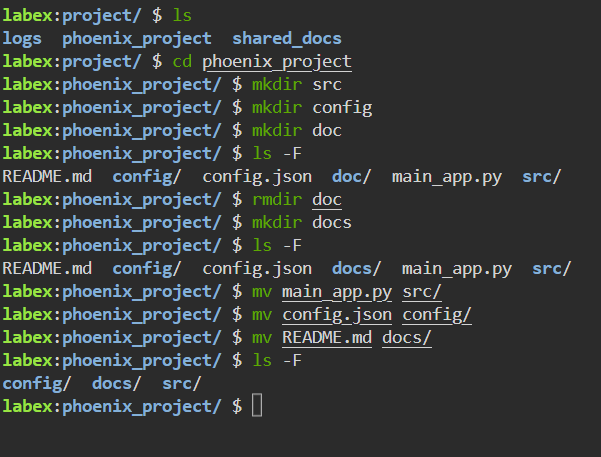
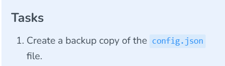
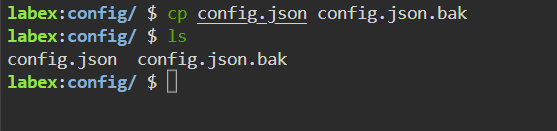
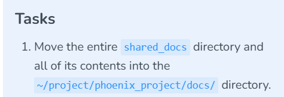
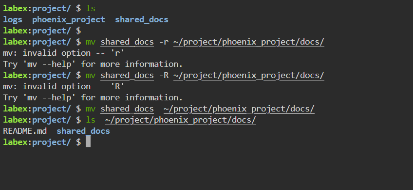

# Lab 003 — Project Directory Structure and Verification

**Platform:** LabEx · The Digital Architect  
**Date:** October 16, 2026  
**Status:** Directory creation, file-move commands, and configuration backup creation evidenced. Configuration-directory listing verified; source destination contents remain to be listed. A later step verifies the documentation directory contains `README.md` and `shared_docs`.

## Objective

Organize `~/project/phoenix_project` with `src`, `config`, and `docs` subdirectories for source code, configuration, and documentation.

## Actions performed

I inspected the project directory, navigated into `phoenix_project`, and created the requested subdirectories. I initially named the documentation directory `doc`, identified the mismatch, removed the empty directory, and created `docs`. I verified the corrected names with `ls -F`.

```bash
ls
cd phoenix_project
mkdir src
mkdir config
mkdir doc
ls -F
rmdir doc
mkdir docs
ls -F
```

## Verified result

The final listing shows:

```text
README.md  config/  config.json  docs/  main_app.py  src/
```

| Directory | Intended purpose |
|---|---|
| `src/` | Source code |
| `config/` | Configuration files |
| `docs/` | Documentation |

At this initial stage, `main_app.py`, `config.json`, and `README.md` remained at the project root. The next section records their subsequent organization.

## Evidence



*Figure 1: Required project directory structure.*



*Figure 2: Initial creation and listing before the naming correction.*



*Figure 3: Final directory verification after correcting the documentation directory.*

## Troubleshooting and lessons learned

- Exact names matter: `doc` and `docs` are different paths.
- `rmdir` removes empty directories; it succeeded for the unused `doc` directory.
- `ls -F` adds classification indicators, including a trailing slash for directories.
- A consistent directory layout supports maintainability and prepares for deliberate access-control configuration. No ownership or permission changes are evidenced in this step.

## Organizing existing project files

I moved each existing project file into its designated directory and inspected the project root again.

```bash
mv main_app.py src/
mv config.json config/
mv README.md docs/
ls -F
```

The final root listing shows:

```text
config/  docs/  src/
```

| Source file | Destination specified |
|---|---|
| `main_app.py` | `src/main_app.py` |
| `config.json` | `config/config.json` |
| `README.md` | `docs/README.md` |

The terminal shows no errors from the three `mv` commands, and the files no longer appear in the root listing. A later screenshot below confirms `config.json` in the configuration directory. Listings inside `src/` and `docs/` are still needed for direct confirmation of their contents.



*Figure 4: Required source-code, configuration, and documentation destinations.*



*Figure 5: File-move commands and resulting project-root listing.*

**Command interpretation:** `mv source directory/` relocates a file into that directory. Unlike `cp`, it does not leave a second copy at the original path. The trailing slash makes the directory destination explicit.

**Follow-up verification (suggested, not yet evidenced):**

```bash
ls -l src/ config/ docs/
```

This exercise follows the LabEx requirement to place `README.md` in `docs/`. The GitHub lab report remains in this project's root so visitors can read it directly.

## Creating a configuration backup

From the `config` directory, I copied `config.json` to `config.json.bak` and listed the directory to verify that both filenames were present.

```bash
cp config.json config.json.bak
ls
```

Observed output:

```text
config.json  config.json.bak
```

The listing confirms the original configuration file and a backup-named file exist together. The `cp` command shows no error. This screenshot does not demonstrate a byte-for-byte comparison, restore test, or an independent backup location.



*Figure 6: Configuration backup requirement.*



*Figure 7: Configuration copy and filename verification.*

**Lesson learned:** `cp` copies a file while leaving the original in place; `mv` relocates or renames it. The `.bak` suffix is a naming convention, not an automatic backup mechanism. A copy in the same directory can support rollback from an edit, but shares the original's storage-failure risk.

**Optional content verification (not yet evidenced):**

```bash
cmp config.json config.json.bak
```

For identical files, `cmp` produces no output and returns exit status `0`.

## Moving an entire directory

From `~/project`, I moved `shared_docs` into the project's `docs` directory. My first two attempts used `-r` and `-R`; both failed because `mv` does not support those options. I removed the flag and verified the destination listing.

```bash
mv shared_docs -r ~/project/phoenix_project/docs/
# mv: invalid option -- 'r'

mv shared_docs -R ~/project/phoenix_project/docs/
# mv: invalid option -- 'R'

mv shared_docs ~/project/phoenix_project/docs/
ls ~/project/phoenix_project/docs/
```

Observed listing:

```text
README.md  shared_docs
```

The corrected move shows no error, and the listing confirms `shared_docs` and `README.md` are present in `docs`. Individual files inside `shared_docs` were not listed, so their contents have not been independently verified.



*Figure 8: Directory-move requirement.*



*Figure 9: Troubleshooting unsupported flags and verifying the destination.*

**Lesson learned:** `mv` moves directories with their contents without a recursive flag. `cp -r` is used to copy a directory recursively; that option does not transfer to `mv`.

**Suggested follow-up (not yet evidenced):**

```bash
ls -la ~/project/phoenix_project/docs/shared_docs/
```

## Next step

Continue the next LabEx task and capture its commands and verification before marking additional work complete.

[← Linux portfolio index](../../README.md)
