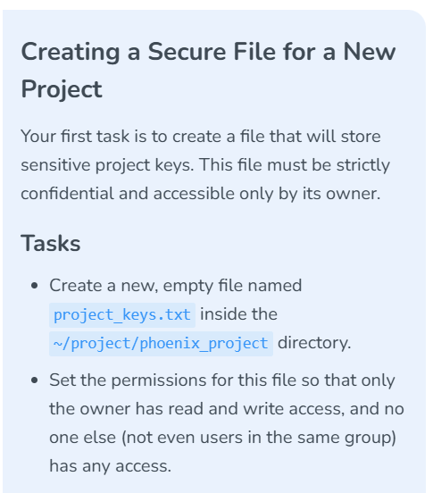
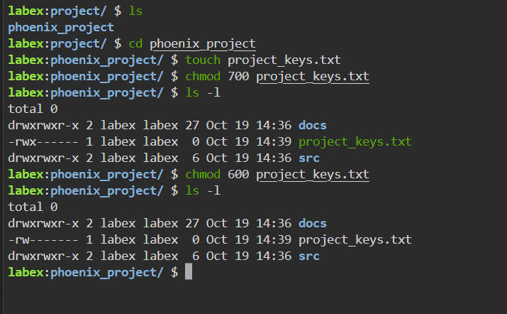

# Lab 005 — Restricting a Project File to Its Owner

**Platform:** LabEx  
**Date:** October 19, 2026  
**Status:** Empty file creation and mode `600` verified with `ls -l`.

## Objective

Create `~/project/phoenix_project/project_keys.txt` and grant read and write access to its owner, with no permissions for group or others.

## Actions performed

I navigated to the project directory and created an empty file. I initially applied mode `700`, noticed the unnecessary owner execute permission, and corrected the mode to `600`. I verified the result with `ls -l`.

```bash
ls
cd phoenix_project
touch project_keys.txt
chmod 700 project_keys.txt
ls -l
chmod 600 project_keys.txt
ls -l
```

## Verified result

The final listing shows a zero-byte regular file owned by user `labex` and group `labex`, with permission string `-rw-------`.

| Identity | Numeric value | Permissions |
|---|---|---|
| Owner | `6 = 4 + 2` | Read and write |
| Group | `0` | None |
| Others | `0` | None |

The leading `-` identifies a regular file. The following nine characters describe owner, group, and other permissions.

## Evidence



*Figure 1: Owner-only access requirement.*



*Figure 2: Correction and verification of mode 600.*

## Troubleshooting and security interpretation

- Mode `700` grants the owner read, write, and execute access. Mode `600` satisfies this regular-file task without execute permission.
- `touch` creates a missing empty file; on an existing file it normally updates timestamps rather than clearing contents. The observed size here is zero bytes.
- Mode bits grant no access to group or others, including other members of the `labex` group. Privileged processes may still bypass ordinary discretionary access controls.
- `chmod` controls access; it does not encrypt contents. No actual keys or credentials were added or published.
- The screenshot demonstrates a permissions listing, not a cross-user access test.

## Optional follow-up

For creating a new sensitive file with restrictive permissions from the outset, a shell can use `umask 077` before creation. This is a suggested improvement, not a command shown as performed.

## Assigning project ownership

I changed the owner and group of the project directory and its contents recursively:

```bash
sudo chown -R dev_lead:developers phoenix_project
ls -l
```

The screenshot shows this command run from `~/project`, followed by a directory entry owned by `dev_lead` and group `developers` with mode `drwxrwxr-x` (`775`).

| Component | Meaning |
|---|---|
| `sudo` | Run with elevated privileges |
| `chown` | Change ownership |
| `-R` | Apply recursively to the directory tree |
| `dev_lead:developers` | Set user owner and group owner together |
| `phoenix_project` | Target relative to the current directory |

The command shows no visible errors. The listing directly confirms the top-level directory ownership; it does not list every nested file. Recursive verification remains to be captured:

```bash
ls -lR ~/project/phoenix_project
```

**Access-control implication:** Ownership and mode bits serve different purposes. `chown` changes who owns the resources; `chmod` controls their permission bits. The previously evidenced `600` key file would grant ordinary owner read/write access to its new owner after a successful ownership transfer; no new listing of that file is shown here.

**Evidence:** Two user-shared screenshots show the ownership task and terminal result. Their image files were not available for upload in this update; the observed command and result are recorded here without claiming recursive verification.

[← Linux portfolio index](../../README.md)
