# Lab 006 — Team Access and Special Permissions

**Platform:** LabEx  
**Date:** October 30, 2026  
**Status:** In progress — current identity, practice-account creation, home permissions, supplementary group memberships, report ownership/mode, and contractor password lock/unlock verified.

## Objective

Build a small team environment using dedicated practice accounts to explore Linux identity, ownership, and access controls.

## Planned scope

- Create a practice user and manage primary and supplementary group membership.
- Secure a file and inspect a password lock.
- Control default permissions with `umask`.
- Configure sticky-bit and setgid directories.

All work is scoped to the lab environment. The exercise specifies leaving the default `labex` login path unchanged.

## Evidence

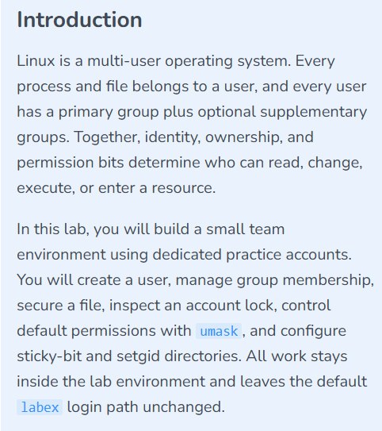

*Exercise introduction and planned scope. This screenshot contains no executed commands or verified configuration changes.*

## Progress

| Stage | Evidence |
|---|---|
| Lab introduction | Captured |
| User and group configuration | Account, primary group, and supplementary memberships verified; session refresh pending |
| File permissions and password-lock inspection | Report ownership/mode 640 and password lock/unlock transitions verified |
| Default permissions and special directory permissions | Pending |

Subsequent sections will record the commands performed, observed output, and access checks as the lab progresses.

## Inspecting identities and creating a practice account

I confirmed the current shell identity, created a dedicated practice account, and inspected its identity and home directory.

```bash
whoami
id
sudo useradd -m -U -s /bin/bash jack
id jack
ls -ld /home/jack
```

### Observed results

```text
labex
uid=5000(labex) gid=5000(labex) groups=5000(labex),27(sudo),121(ssl-cert),5002(public)
uid=5002(jack) gid=5003(jack) groups=5003(jack)
drwxr-x--- 2 jack jack 57 Oct 30 16:54 /home/jack
```

| Check | Verified result |
|---|---|
| Current shell user | `labex` |
| LabEx identity | UID `5000`, primary GID `5000`; listed groups `labex`, `sudo`, `ssl-cert`, and `public` |
| Jack's identity | UID `5002`, primary GID `5003`; listed group `jack` |
| Home directory | `/home/jack` exists and is owned by `jack:jack` |
| Home permissions | `750` (`rwxr-x---`): owner full directory permissions, group list/traverse, others no access through ordinary mode bits |

The `-m` option requests home-directory creation, `-U` creates a same-named primary group, and `-s /bin/bash` selects Bash as the login shell. The identity and directory checks confirm the account and home directory. The configured shell was requested but not independently queried in the displayed output.

A UID and a GID belong to separate namespaces: Jack's UID `5002` matching the numeric GID of `public` does not make Jack a member of that group.

### Screenshots

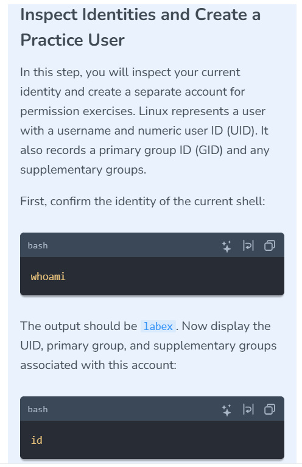

*Current-user and identity inspection requirements.*

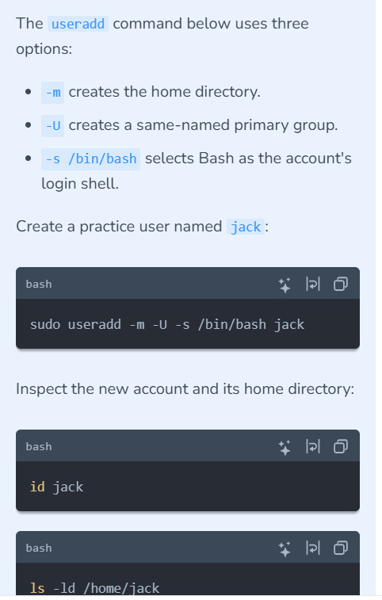

*Practice-account creation and verification requirements.*

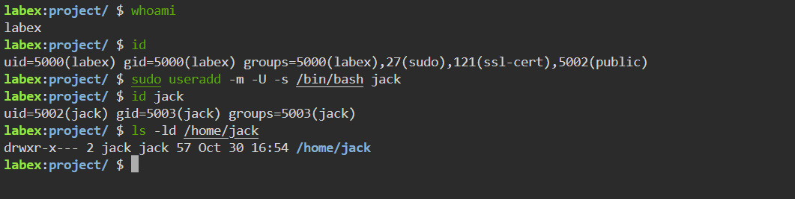

*Executed commands and observed verification results.*

**Verification scope:** No password configuration, login attempt, supplementary-group assignment for Jack, or file-access test is shown yet. A follow-up `getent passwd jack` can confirm the configured shell without exposing authentication data.

## Managing supplementary groups

I created a shared team group, appended supplementary memberships, and queried both accounts.

```bash
sudo groupadd developers
sudo usermod -aG developers,sudo jack
sudo usermod -aG developers labex
groups jack
groups labex
```

Observed output:

```text
jack : jack sudo developers
labex : labex sudo ssl-cert public developers
```

| Account | Verified group list |
|---|---|
| `jack` | `jack`, `sudo`, `developers` |
| `labex` | `labex`, `sudo`, `ssl-cert`, `public`, `developers` |

The `-G` option specifies supplementary groups, and `-a` appends them rather than replacing existing supplementary memberships. The output confirms that LabEx's previously listed groups were retained and `developers` was added.

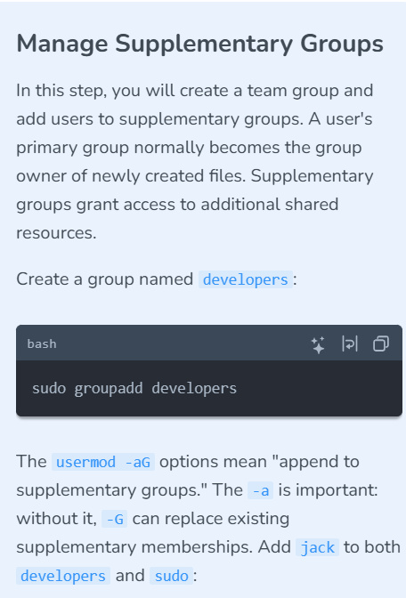

*Shared-group creation and membership requirements.*

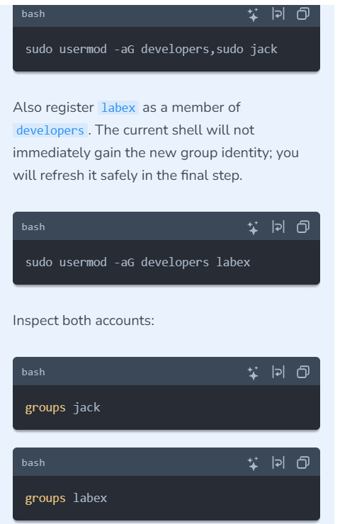

*Membership commands and account queries.*

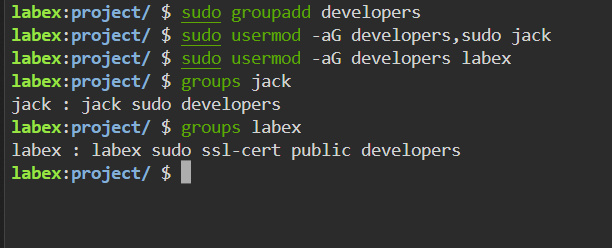

*Group memberships verified through account queries.*

**Session and privilege scope:** `groups labex` queries the account's configured memberships; it does not prove the current shell has acquired the new group identity. Session refresh and shared-resource access tests remain pending. Jack's `sudo` membership is evidenced, but successful privileged execution as Jack is not shown; authorization also depends on sudoers policy.

## Controlling file ownership and permissions

I assigned the team report to Jack and the shared development group, applied mode `640`, and verified the metadata with both `ls` and `stat`.

```bash
sudo chown jack:developers /home/labex/project/secure-report.txt
sudo chmod 640 /home/labex/project/secure-report.txt
ls -l /home/labex/project/secure-report.txt
stat -c 'owner=%U group=%G mode=%a' /home/labex/project/secure-report.txt
```

Observed listing:

```text
-rw-r----- 1 jack developers 0 Oct 30 17:06 /home/labex/project/secure-report.txt
owner=jack group=developers mode=640
```

| Identity | Mode bits | File permissions |
|---|---|---|
| Owner `jack` | `rw-` (`6`) | Read and write |
| Group `developers` | `r--` (`4`) | Read only |
| Others | `---` (`0`) | No access through ordinary mode bits |

The listing confirms a regular, empty file owned by `jack:developers`. No execute bits are set. The `user:group` form of `chown` sets both ownership fields in one command.

**Troubleshooting:** The first `stat` command targeted `/home/labex/project/secure.txt`, which did not exist. Correcting the path to `secure-report.txt` returned the expected ownership and mode. The error reflected a filename mismatch, not a failed permission change.

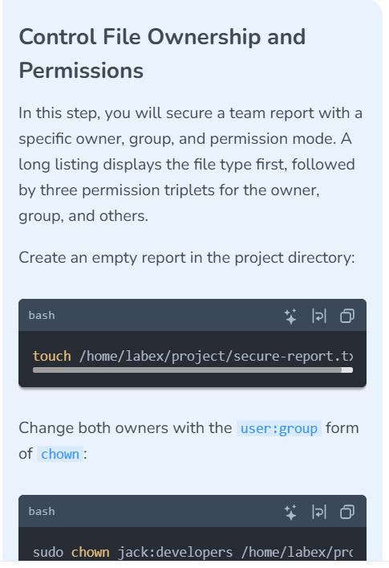

*Report creation and ownership requirements.*

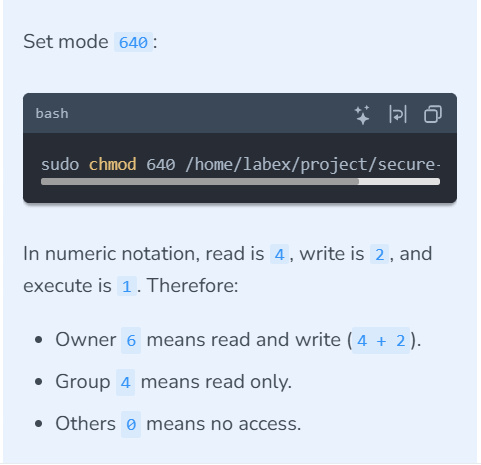

*Owner read/write, group read, and no permissions for others.*

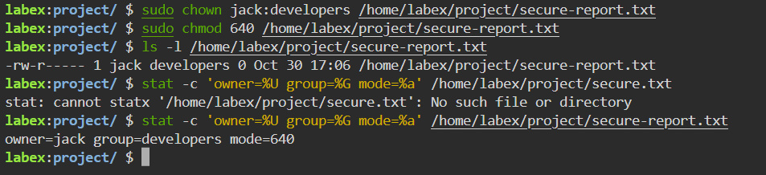

*Ownership and mode verified independently with a long listing and formatted metadata.*

**Evidence scope:** The task requests `touch`, but its execution is not visible in the terminal screenshot. The final listing verifies that the empty file exists. These are metadata checks; reads and writes as Jack, another developer, or an unrelated user have not been demonstrated. Effective access also depends on parent-directory traversal and any applicable ACLs or other controls.

## Inspecting and changing a password lock

I inspected only the first character of the practice account's password field, locked its password, and then unlocked it. The pipeline keeps the password hash out of the displayed output.

```bash
sudo getent shadow contractor | cut -d: -f2 | cut -c1
sudo usermod -L contractor
sudo getent shadow contractor | cut -d: -f2 | cut -c1
sudo usermod -U contractor
sudo getent shadow contractor | cut -d: -f2 | cut -c1
```

| Stage | Observed character | Interpretation |
|---|---|---|
| Before locking | `# Lab 006 — Team Access and Special Permissions

**Platform:** LabEx  
**Date:** October 30, 2026  
**Status:** In progress — current identity, practice-account creation, home permissions, supplementary group memberships, report ownership/mode, and contractor password lock/unlock verified.

## Objective

Build a small team environment using dedicated practice accounts to explore Linux identity, ownership, and access controls.

## Planned scope

- Create a practice user and manage primary and supplementary group membership.
- Secure a file and inspect a password lock.
- Control default permissions with `umask`.
- Configure sticky-bit and setgid directories.

All work is scoped to the lab environment. The exercise specifies leaving the default `labex` login path unchanged.

## Evidence


*Exercise introduction and planned scope. This screenshot contains no executed commands or verified configuration changes.*

## Progress

| Stage | Evidence |
|---|---|
| Lab introduction | Captured |
| User and group configuration | Account, primary group, and supplementary memberships verified; session refresh pending |
| File permissions and password-lock inspection | Report ownership/mode 640 and password lock/unlock transitions verified |
| Default permissions and special directory permissions | Pending |

Subsequent sections will record the commands performed, observed output, and access checks as the lab progresses.

## Inspecting identities and creating a practice account

I confirmed the current shell identity, created a dedicated practice account, and inspected its identity and home directory.

```bash
whoami
id
sudo useradd -m -U -s /bin/bash jack
id jack
ls -ld /home/jack
```

### Observed results

```text
labex
uid=5000(labex) gid=5000(labex) groups=5000(labex),27(sudo),121(ssl-cert),5002(public)
uid=5002(jack) gid=5003(jack) groups=5003(jack)
drwxr-x--- 2 jack jack 57 Oct 30 16:54 /home/jack
```

| Check | Verified result |
|---|---|
| Current shell user | `labex` |
| LabEx identity | UID `5000`, primary GID `5000`; listed groups `labex`, `sudo`, `ssl-cert`, and `public` |
| Jack's identity | UID `5002`, primary GID `5003`; listed group `jack` |
| Home directory | `/home/jack` exists and is owned by `jack:jack` |
| Home permissions | `750` (`rwxr-x---`): owner full directory permissions, group list/traverse, others no access through ordinary mode bits |

The `-m` option requests home-directory creation, `-U` creates a same-named primary group, and `-s /bin/bash` selects Bash as the login shell. The identity and directory checks confirm the account and home directory. The configured shell was requested but not independently queried in the displayed output.

A UID and a GID belong to separate namespaces: Jack's UID `5002` matching the numeric GID of `public` does not make Jack a member of that group.

### Screenshots


*Current-user and identity inspection requirements.*


*Practice-account creation and verification requirements.*


*Executed commands and observed verification results.*

**Verification scope:** No password configuration, login attempt, supplementary-group assignment for Jack, or file-access test is shown yet. A follow-up `getent passwd jack` can confirm the configured shell without exposing authentication data.

## Managing supplementary groups

I created a shared team group, appended supplementary memberships, and queried both accounts.

```bash
sudo groupadd developers
sudo usermod -aG developers,sudo jack
sudo usermod -aG developers labex
groups jack
groups labex
```

Observed output:

```text
jack : jack sudo developers
labex : labex sudo ssl-cert public developers
```

| Account | Verified group list |
|---|---|
| `jack` | `jack`, `sudo`, `developers` |
| `labex` | `labex`, `sudo`, `ssl-cert`, `public`, `developers` |

The `-G` option specifies supplementary groups, and `-a` appends them rather than replacing existing supplementary memberships. The output confirms that LabEx's previously listed groups were retained and `developers` was added.


*Shared-group creation and membership requirements.*


*Membership commands and account queries.*


*Group memberships verified through account queries.*

**Session and privilege scope:** `groups labex` queries the account's configured memberships; it does not prove the current shell has acquired the new group identity. Session refresh and shared-resource access tests remain pending. Jack's `sudo` membership is evidenced, but successful privileged execution as Jack is not shown; authorization also depends on sudoers policy.

## Controlling file ownership and permissions

I assigned the team report to Jack and the shared development group, applied mode `640`, and verified the metadata with both `ls` and `stat`.

```bash
sudo chown jack:developers /home/labex/project/secure-report.txt
sudo chmod 640 /home/labex/project/secure-report.txt
ls -l /home/labex/project/secure-report.txt
stat -c 'owner=%U group=%G mode=%a' /home/labex/project/secure-report.txt
```

Observed listing:

```text
-rw-r----- 1 jack developers 0 Oct 30 17:06 /home/labex/project/secure-report.txt
owner=jack group=developers mode=640
```

| Identity | Mode bits | File permissions |
|---|---|---|
| Owner `jack` | `rw-` (`6`) | Read and write |
| Group `developers` | `r--` (`4`) | Read only |
| Others | `---` (`0`) | No access through ordinary mode bits |

The listing confirms a regular, empty file owned by `jack:developers`. No execute bits are set. The `user:group` form of `chown` sets both ownership fields in one command.

**Troubleshooting:** The first `stat` command targeted `/home/labex/project/secure.txt`, which did not exist. Correcting the path to `secure-report.txt` returned the expected ownership and mode. The error reflected a filename mismatch, not a failed permission change.


*Report creation and ownership requirements.*


*Owner read/write, group read, and no permissions for others.*


*Ownership and mode verified independently with a long listing and formatted metadata.*

**Evidence scope:** The task requests `touch`, but its execution is not visible in the terminal screenshot. The final listing verifies that the empty file exists. These are metadata checks; reads and writes as Jack, another developer, or an unrelated user have not been demonstrated. Effective access also depends on parent-directory traversal and any applicable ACLs or other controls.

 | Password field begins with a modular hash-format marker |
| After `usermod -L` | `!` | Password authentication is locked |
| After `usermod -U` | `# Lab 006 — Team Access and Special Permissions

**Platform:** LabEx  
**Date:** October 30, 2026  
**Status:** In progress — current identity, practice-account creation, home permissions, supplementary group memberships, report ownership/mode, and contractor password lock/unlock verified.

## Objective

Build a small team environment using dedicated practice accounts to explore Linux identity, ownership, and access controls.

## Planned scope

- Create a practice user and manage primary and supplementary group membership.
- Secure a file and inspect a password lock.
- Control default permissions with `umask`.
- Configure sticky-bit and setgid directories.

All work is scoped to the lab environment. The exercise specifies leaving the default `labex` login path unchanged.

## Evidence


*Exercise introduction and planned scope. This screenshot contains no executed commands or verified configuration changes.*

## Progress

| Stage | Evidence |
|---|---|
| Lab introduction | Captured |
| User and group configuration | Account, primary group, and supplementary memberships verified; session refresh pending |
| File permissions and password-lock inspection | Report ownership/mode 640 and password lock/unlock transitions verified |
| Default permissions and special directory permissions | Pending |

Subsequent sections will record the commands performed, observed output, and access checks as the lab progresses.

## Inspecting identities and creating a practice account

I confirmed the current shell identity, created a dedicated practice account, and inspected its identity and home directory.

```bash
whoami
id
sudo useradd -m -U -s /bin/bash jack
id jack
ls -ld /home/jack
```

### Observed results

```text
labex
uid=5000(labex) gid=5000(labex) groups=5000(labex),27(sudo),121(ssl-cert),5002(public)
uid=5002(jack) gid=5003(jack) groups=5003(jack)
drwxr-x--- 2 jack jack 57 Oct 30 16:54 /home/jack
```

| Check | Verified result |
|---|---|
| Current shell user | `labex` |
| LabEx identity | UID `5000`, primary GID `5000`; listed groups `labex`, `sudo`, `ssl-cert`, and `public` |
| Jack's identity | UID `5002`, primary GID `5003`; listed group `jack` |
| Home directory | `/home/jack` exists and is owned by `jack:jack` |
| Home permissions | `750` (`rwxr-x---`): owner full directory permissions, group list/traverse, others no access through ordinary mode bits |

The `-m` option requests home-directory creation, `-U` creates a same-named primary group, and `-s /bin/bash` selects Bash as the login shell. The identity and directory checks confirm the account and home directory. The configured shell was requested but not independently queried in the displayed output.

A UID and a GID belong to separate namespaces: Jack's UID `5002` matching the numeric GID of `public` does not make Jack a member of that group.

### Screenshots


*Current-user and identity inspection requirements.*


*Practice-account creation and verification requirements.*


*Executed commands and observed verification results.*

**Verification scope:** No password configuration, login attempt, supplementary-group assignment for Jack, or file-access test is shown yet. A follow-up `getent passwd jack` can confirm the configured shell without exposing authentication data.

## Managing supplementary groups

I created a shared team group, appended supplementary memberships, and queried both accounts.

```bash
sudo groupadd developers
sudo usermod -aG developers,sudo jack
sudo usermod -aG developers labex
groups jack
groups labex
```

Observed output:

```text
jack : jack sudo developers
labex : labex sudo ssl-cert public developers
```

| Account | Verified group list |
|---|---|
| `jack` | `jack`, `sudo`, `developers` |
| `labex` | `labex`, `sudo`, `ssl-cert`, `public`, `developers` |

The `-G` option specifies supplementary groups, and `-a` appends them rather than replacing existing supplementary memberships. The output confirms that LabEx's previously listed groups were retained and `developers` was added.


*Shared-group creation and membership requirements.*


*Membership commands and account queries.*


*Group memberships verified through account queries.*

**Session and privilege scope:** `groups labex` queries the account's configured memberships; it does not prove the current shell has acquired the new group identity. Session refresh and shared-resource access tests remain pending. Jack's `sudo` membership is evidenced, but successful privileged execution as Jack is not shown; authorization also depends on sudoers policy.

## Controlling file ownership and permissions

I assigned the team report to Jack and the shared development group, applied mode `640`, and verified the metadata with both `ls` and `stat`.

```bash
sudo chown jack:developers /home/labex/project/secure-report.txt
sudo chmod 640 /home/labex/project/secure-report.txt
ls -l /home/labex/project/secure-report.txt
stat -c 'owner=%U group=%G mode=%a' /home/labex/project/secure-report.txt
```

Observed listing:

```text
-rw-r----- 1 jack developers 0 Oct 30 17:06 /home/labex/project/secure-report.txt
owner=jack group=developers mode=640
```

| Identity | Mode bits | File permissions |
|---|---|---|
| Owner `jack` | `rw-` (`6`) | Read and write |
| Group `developers` | `r--` (`4`) | Read only |
| Others | `---` (`0`) | No access through ordinary mode bits |

The listing confirms a regular, empty file owned by `jack:developers`. No execute bits are set. The `user:group` form of `chown` sets both ownership fields in one command.

**Troubleshooting:** The first `stat` command targeted `/home/labex/project/secure.txt`, which did not exist. Correcting the path to `secure-report.txt` returned the expected ownership and mode. The error reflected a filename mismatch, not a failed permission change.


*Report creation and ownership requirements.*


*Owner read/write, group read, and no permissions for others.*


*Ownership and mode verified independently with a long listing and formatted metadata.*

**Evidence scope:** The task requests `touch`, but its execution is not visible in the terminal screenshot. The final listing verifies that the empty file exists. These are metadata checks; reads and writes as Jack, another developer, or an unrelated user have not been demonstrated. Effective access also depends on parent-directory traversal and any applicable ACLs or other controls.

 | Leading lock marker removed; prior hash-format prefix restored |

The first `cut` selects the second colon-delimited field of the shadow record; the second selects only its first character. No full password hash or password value is exposed in these screenshots.

**Troubleshooting:** An initial lock attempt used the misspelled username `contrator` and returned a nonexistent-user error. Correcting it to `contractor` allowed the lock operation and subsequent verification to proceed.

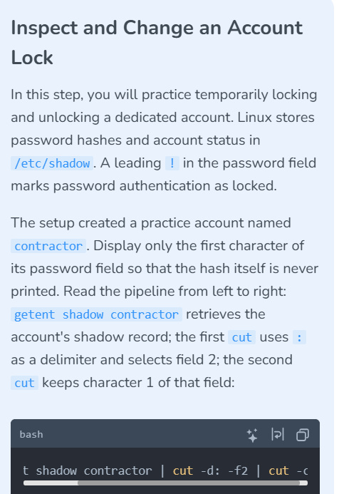

*Inspecting a password-lock marker without displaying the hash.*

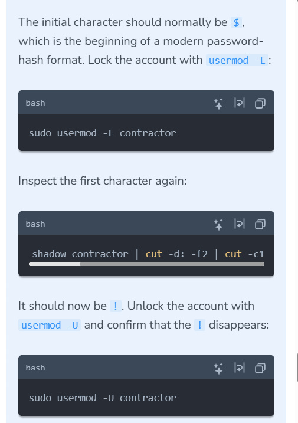

*Expected password-field transitions.*

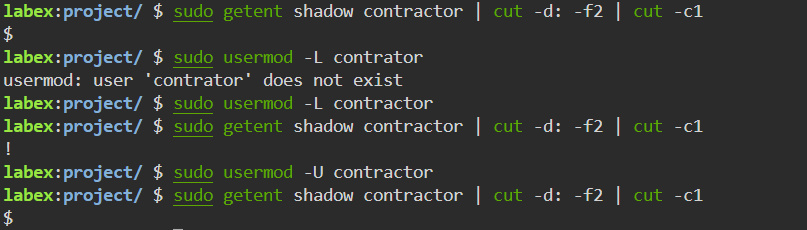

*Password-lock state transitions verified after correcting a username typo.*

**Verification scope:** These checks establish the observed password-field transitions. They do not demonstrate successful or failed login attempts, termination of existing sessions, or revocation of SSH-key access. Password locking is one authentication control, not proof of complete account suspension. A `# Lab 006 — Team Access and Special Permissions

**Platform:** LabEx  
**Date:** October 30, 2026  
**Status:** In progress — current identity, practice-account creation, home permissions, supplementary group memberships, report ownership/mode, and contractor password lock/unlock verified.

## Objective

Build a small team environment using dedicated practice accounts to explore Linux identity, ownership, and access controls.

## Planned scope

- Create a practice user and manage primary and supplementary group membership.
- Secure a file and inspect a password lock.
- Control default permissions with `umask`.
- Configure sticky-bit and setgid directories.

All work is scoped to the lab environment. The exercise specifies leaving the default `labex` login path unchanged.

## Evidence


*Exercise introduction and planned scope. This screenshot contains no executed commands or verified configuration changes.*

## Progress

| Stage | Evidence |
|---|---|
| Lab introduction | Captured |
| User and group configuration | Account, primary group, and supplementary memberships verified; session refresh pending |
| File permissions and password-lock inspection | Report ownership/mode 640 and password lock/unlock transitions verified |
| Default permissions and special directory permissions | Pending |

Subsequent sections will record the commands performed, observed output, and access checks as the lab progresses.

## Inspecting identities and creating a practice account

I confirmed the current shell identity, created a dedicated practice account, and inspected its identity and home directory.

```bash
whoami
id
sudo useradd -m -U -s /bin/bash jack
id jack
ls -ld /home/jack
```

### Observed results

```text
labex
uid=5000(labex) gid=5000(labex) groups=5000(labex),27(sudo),121(ssl-cert),5002(public)
uid=5002(jack) gid=5003(jack) groups=5003(jack)
drwxr-x--- 2 jack jack 57 Oct 30 16:54 /home/jack
```

| Check | Verified result |
|---|---|
| Current shell user | `labex` |
| LabEx identity | UID `5000`, primary GID `5000`; listed groups `labex`, `sudo`, `ssl-cert`, and `public` |
| Jack's identity | UID `5002`, primary GID `5003`; listed group `jack` |
| Home directory | `/home/jack` exists and is owned by `jack:jack` |
| Home permissions | `750` (`rwxr-x---`): owner full directory permissions, group list/traverse, others no access through ordinary mode bits |

The `-m` option requests home-directory creation, `-U` creates a same-named primary group, and `-s /bin/bash` selects Bash as the login shell. The identity and directory checks confirm the account and home directory. The configured shell was requested but not independently queried in the displayed output.

A UID and a GID belong to separate namespaces: Jack's UID `5002` matching the numeric GID of `public` does not make Jack a member of that group.

### Screenshots


*Current-user and identity inspection requirements.*


*Practice-account creation and verification requirements.*


*Executed commands and observed verification results.*

**Verification scope:** No password configuration, login attempt, supplementary-group assignment for Jack, or file-access test is shown yet. A follow-up `getent passwd jack` can confirm the configured shell without exposing authentication data.

## Managing supplementary groups

I created a shared team group, appended supplementary memberships, and queried both accounts.

```bash
sudo groupadd developers
sudo usermod -aG developers,sudo jack
sudo usermod -aG developers labex
groups jack
groups labex
```

Observed output:

```text
jack : jack sudo developers
labex : labex sudo ssl-cert public developers
```

| Account | Verified group list |
|---|---|
| `jack` | `jack`, `sudo`, `developers` |
| `labex` | `labex`, `sudo`, `ssl-cert`, `public`, `developers` |

The `-G` option specifies supplementary groups, and `-a` appends them rather than replacing existing supplementary memberships. The output confirms that LabEx's previously listed groups were retained and `developers` was added.


*Shared-group creation and membership requirements.*


*Membership commands and account queries.*


*Group memberships verified through account queries.*

**Session and privilege scope:** `groups labex` queries the account's configured memberships; it does not prove the current shell has acquired the new group identity. Session refresh and shared-resource access tests remain pending. Jack's `sudo` membership is evidenced, but successful privileged execution as Jack is not shown; authorization also depends on sudoers policy.

## Controlling file ownership and permissions

I assigned the team report to Jack and the shared development group, applied mode `640`, and verified the metadata with both `ls` and `stat`.

```bash
sudo chown jack:developers /home/labex/project/secure-report.txt
sudo chmod 640 /home/labex/project/secure-report.txt
ls -l /home/labex/project/secure-report.txt
stat -c 'owner=%U group=%G mode=%a' /home/labex/project/secure-report.txt
```

Observed listing:

```text
-rw-r----- 1 jack developers 0 Oct 30 17:06 /home/labex/project/secure-report.txt
owner=jack group=developers mode=640
```

| Identity | Mode bits | File permissions |
|---|---|---|
| Owner `jack` | `rw-` (`6`) | Read and write |
| Group `developers` | `r--` (`4`) | Read only |
| Others | `---` (`0`) | No access through ordinary mode bits |

The listing confirms a regular, empty file owned by `jack:developers`. No execute bits are set. The `user:group` form of `chown` sets both ownership fields in one command.

**Troubleshooting:** The first `stat` command targeted `/home/labex/project/secure.txt`, which did not exist. Correcting the path to `secure-report.txt` returned the expected ownership and mode. The error reflected a filename mismatch, not a failed permission change.


*Report creation and ownership requirements.*


*Owner read/write, group read, and no permissions for others.*


*Ownership and mode verified independently with a long listing and formatted metadata.*

**Evidence scope:** The task requests `touch`, but its execution is not visible in the terminal screenshot. The final listing verifies that the empty file exists. These are metadata checks; reads and writes as Jack, another developer, or an unrelated user have not been demonstrated. Effective access also depends on parent-directory traversal and any applicable ACLs or other controls.

 prefix alone does not prove an account can log in.

[← Linux portfolio index](../../README.md)
