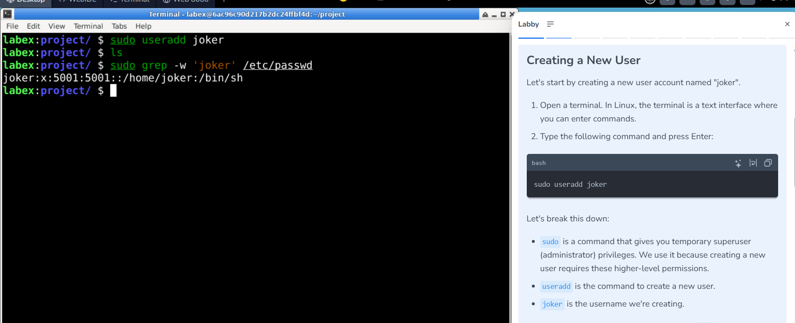
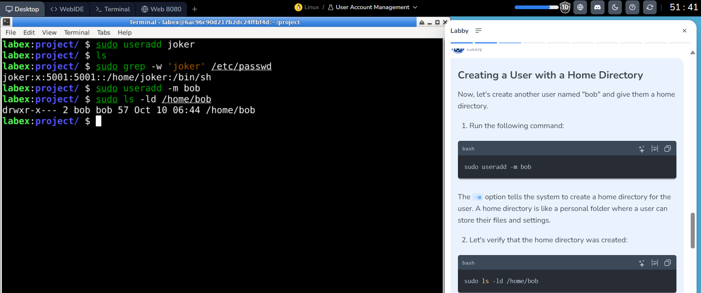
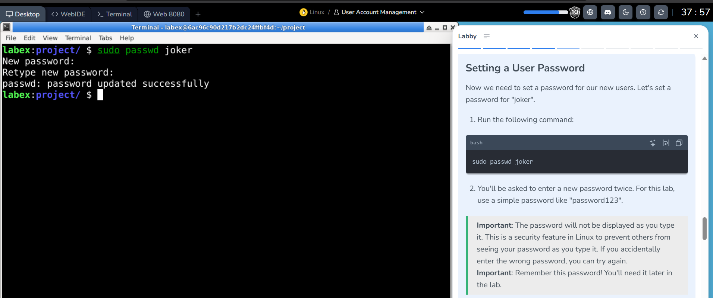
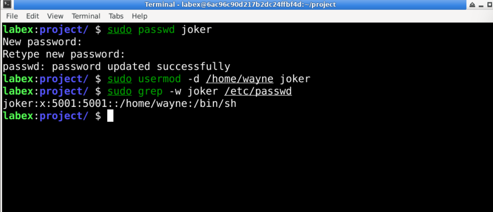
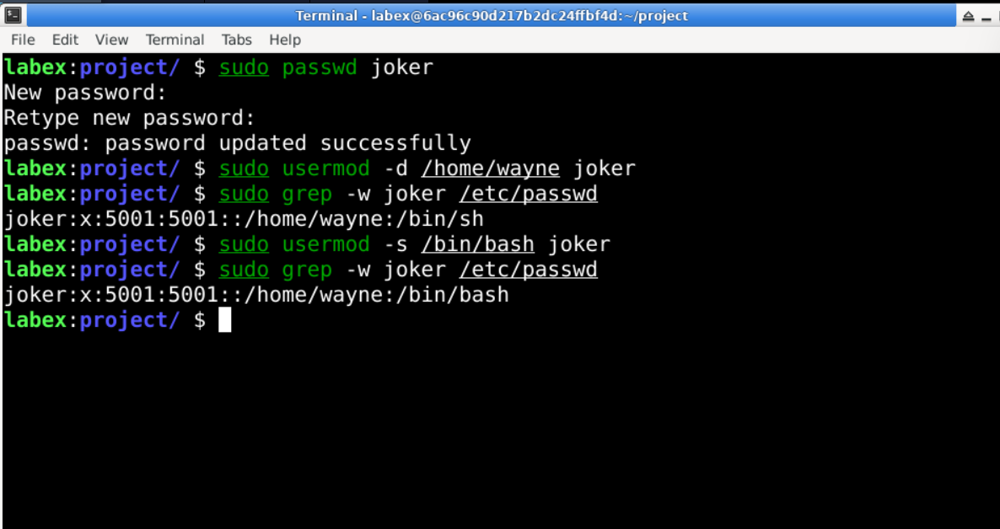
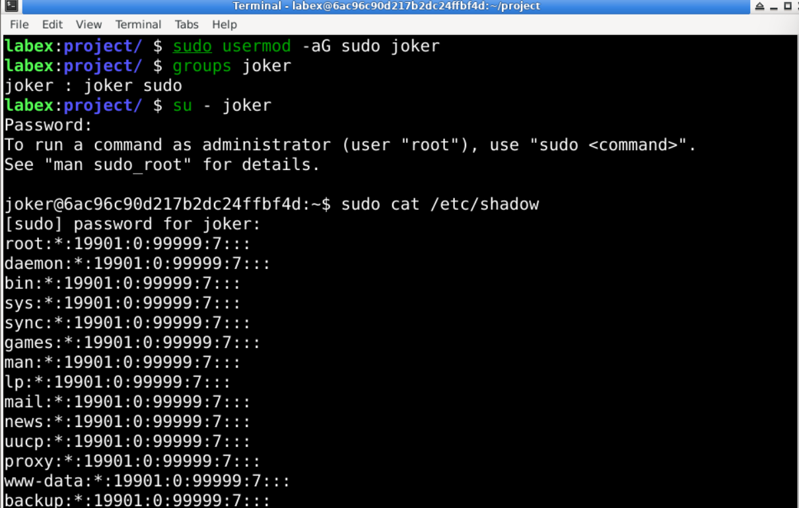
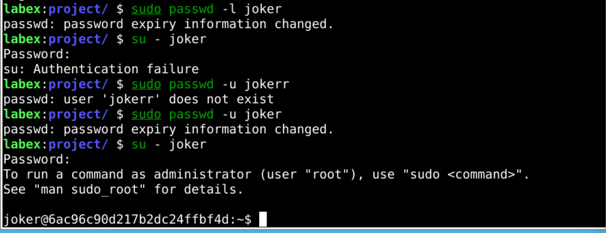
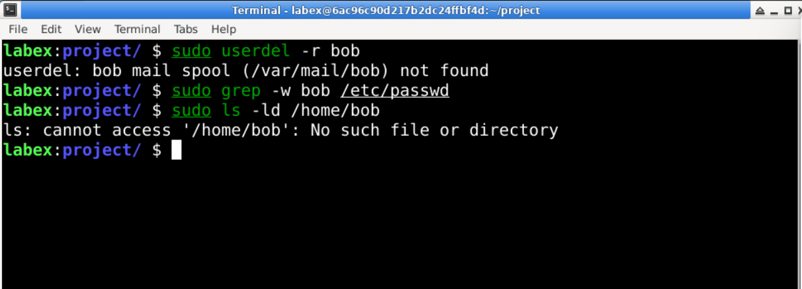
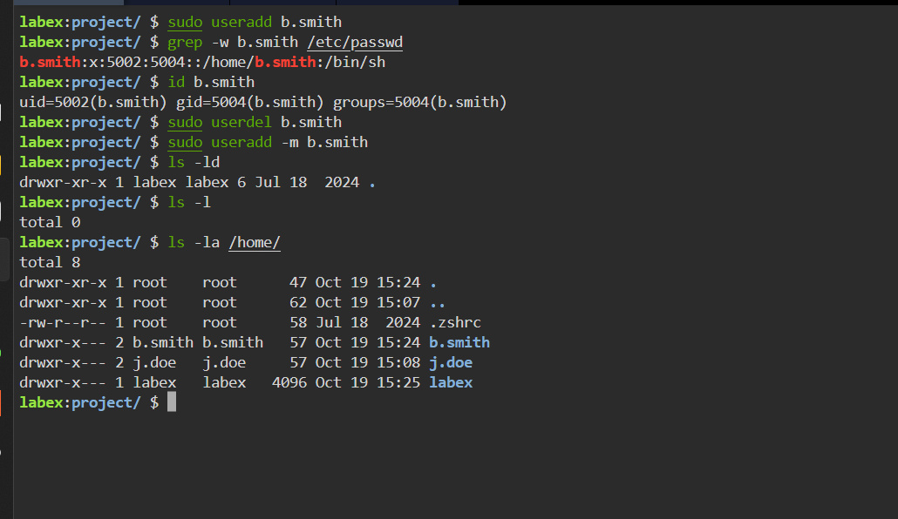

# Lab 002 — Linux User Account Lifecycle and Access Management

**Platform:** LabEx  
**Date:** October 9, 2026  
**Topic:** Linux user administration and account verification  
**Status:** Account creation, Bob's home-directory permissions, Joker's password update, home-path modification, Bash shell configuration, sudo-group membership, interactive login, privileged command execution, password lock/unlock testing, and Bob's account and home-directory removal evidenced.

## Objective

Create and verify local Linux accounts, configure a password, modify a home-directory path, change a login shell, manage administrative group membership, test password locking, and remove a lab account with verification.

## Environment

Interactive Linux terminal in the LabEx learning environment. The terminal prompt shown is `labex:project/`.

## Observed commands

```bash
sudo useradd joker
ls
sudo grep -w 'joker' /etc/passwd
```

**Observed account entry:**

```text
joker:x:5001:5001::/home/joker:/bin/sh
```

## Step-by-step analysis

1. **`sudo useradd joker`** requests creation of the local account `joker` with elevated privileges. The screenshot shows no error message after this command.
2. **`ls`** lists the current directory; the screenshot does not show any directory entries in its output. This is not an account-verification command.
3. **`sudo grep -w 'joker' /etc/passwd`** searches the local account database for the username. The returned entry confirms that an account record named `joker` exists.

### Understanding the `/etc/passwd` record

| Field | Value | Meaning |
|---|---|---|
| Username | `joker` | Local login name |
| Password placeholder | `x` | Password hashes are normally stored separately in `/etc/shadow` |
| UID | `5001` | Numeric user identifier |
| Primary GID | `5001` | Numeric primary group identifier |
| GECOS | empty | Optional descriptive account information |
| Home path | `/home/joker` | Configured home directory path |
| Login shell | `/bin/sh` | Configured shell |

**Important distinction:** A home directory path appearing in `/etc/passwd` does **not** prove that the directory exists. The initial screenshot does not demonstrate password configuration or interactive login; the password update is evidenced later in this report.

## Security significance

Local accounts are security principals. Their UIDs, group memberships, authentication configuration, and login shells affect system access and auditability. Good account management supports least privilege and accountable access.

## Verification to perform next

```bash
id joker
getent passwd joker
ls -ld /home/wayne
sudo passwd -S joker
```

These are **suggested follow-up commands**, not commands shown as completed in the screenshot. Do not publish password hashes or credentials.

## Evidence

- **Source:** User-shared LabEx screenshot from October 9, 2026 showing the account-creation command and `/etc/passwd` output.



*Figure 1: Creating `joker` and confirming the account record in `/etc/passwd`.*

**Initial evidence scope:** Account record creation only. Subsequent evidence below covers Bob's home directory and Joker's password and account-property changes.


## Progress update — creating a user with a home directory

A subsequent LabEx screenshot shows the following commands:

```bash
sudo useradd -m bob
sudo ls -ld /home/bob
```

Observed output:

```text
drwxr-x--- 2 bob bob 57 Oct 10 06:44 /home/bob
```

**What this establishes:** The `-m` option requested creation of a home directory for the new account. The `ls -ld` result confirms that `/home/bob` exists as a directory, is owned by user `bob` and group `bob`, and has permission mode `750` (`rwxr-x---`). The listing shows link count `2` and directory size `57` bytes in this environment. The date/time in the terminal is the lab environment's timestamp, not necessarily the user's local time.

**Permissions interpretation:**

| Identity | Permissions | Meaning |
|---|---|---|
| Owner `bob` | `rwx` | List, create/remove entries (subject to other controls), traverse |
| Group `bob` | `r-x` | List and traverse, but not modify directory entries |
| Others | `---` | No access via ordinary Unix mode bits |

**Security relevance:** Creating an account with a home directory and restricting directory access are foundational to user isolation and least privilege. `sudo ls -ld` checks directory metadata; it does not test Bob's password, interactive login, or access to files inside the directory.

**Next verification (not yet shown as executed):**

```bash
id bob
getent passwd bob
sudo stat /home/bob
```

**Evidence:** LabEx terminal showing `bob` account creation and home-directory verification.



*Figure 2: Creating `bob` with `useradd -m` and verifying `/home/bob` ownership and mode `750`.*

## Password configuration

```bash
sudo passwd joker
```

The terminal reports `passwd: password updated successfully`, confirming a successful password update. Password input is not echoed in the terminal. Successful interactive login is evidenced in the sudo-group verification section below. The lab's example password is for practice only; use a strong, unique password for real accounts.



*Figure 3: Successful password configuration for `joker`.*

## Modifying the configured home path

```bash
sudo usermod -d /home/wayne joker
sudo grep -w joker /etc/passwd
```

Observed account record:

```text
joker:x:5001:5001::/home/wayne:/bin/sh
```

The `-d` option changes the account's configured home path. The returned record confirms `/home/wayne`. This command does not create the directory or move its contents; those operations are not evidenced here. UID and primary GID remain `5001`.



*Figure 4: Home-path modification verified in the account database.*

[LabEx user-properties instructions](screenshots/labex-user-properties-instructions.png) provide exercise context only.

## Changing the login shell

```bash
sudo usermod -s /bin/bash joker
sudo grep -w joker /etc/passwd
```

Observed account record:

```text
joker:x:5001:5001::/home/wayne:/bin/bash
```

The `-s` option changes the configured login shell. The returned entry confirms `/bin/bash`; the home path, UID, and primary GID remain unchanged. This screenshot verifies account configuration. A subsequent login session is evidenced below.



*Figure 5: Bash login-shell configuration verified in the account database.*

[LabEx shell instructions](screenshots/labex-user-shell-instructions.png) provide exercise context only.

## Supplementary group membership and privileged access

```bash
sudo usermod -aG sudo joker
groups joker
su - joker
sudo cat /etc/shadow
exit
```

The group query returns:

```text
joker : joker sudo
```

- `-G sudo` selects a supplementary group; `-a` appends it without replacing existing supplementary memberships.
- `groups joker` confirms membership in `joker` and `sudo`.
- `su - joker` starts a login session as `joker`. The changed prompt confirms the user switch.
- The privileged read returns protected account data after the sudo password prompt, demonstrating successful sudo execution under the lab's policy.
- The subsequent screenshot shows `exit` and return to the `labex` prompt.



*Figure 6: Group membership, authenticated user switching, and sudo execution. This image contains no password hashes.*

[LabEx group-management instructions](screenshots/labex-sudo-group-instructions.png) provide exercise context.

**Security interpretation:** Sudo authorization depends on sudoers policy; a group name alone does not universally grant administrative rights. Adding a user to an administrative group is a significant privilege change and should follow least privilege.

**Evidence handling:** The screenshot containing password hashes and the instruction image displaying the lab password are excluded from the public repository. Protected authentication data is not reproduced in this report. For future verification, use `sudo -l` to inspect allowed commands and `sudo id` to demonstrate elevated execution without exposing password records.

## Password locking and unlocking

The terminal demonstrates the following sequence:

```bash
sudo passwd -l joker
su - joker
sudo passwd -u jokerr
sudo passwd -u joker
su - joker
```

| Action | Observed result |
|---|---|
| Lock `joker` with `passwd -l` | `passwd: password expiry information changed.` |
| Attempt `su - joker` while locked | `su: Authentication failure` |
| Attempt unlock with mistyped `jokerr` | `passwd: user 'jokerr' does not exist` |
| Correct username and run `passwd -u joker` | `passwd: password expiry information changed.` |
| Retry `su - joker` | Login succeeds and the prompt changes to `joker` |



*Figure 7: Password lock-and-unlock behavior verified by login attempts.*

[LabEx password-locking instructions](screenshots/labex-password-locking-instructions.png) provide exercise context.

**Troubleshooting:** The failed unlock targeted a nonexistent account (`jokerr`). Correcting the username resolved that command error.

**Security interpretation:** `passwd -l` locks password authentication; it does not necessarily disable all access to an account. SSH keys, other authentication mechanisms, and existing sessions may remain usable. `passwd -u` unlocks the password. This exercise demonstrates the observed password-based `su` behavior, not complete account suspension.

**Suggested follow-up (not yet evidenced):** Use `sudo passwd -S joker` to inspect password status without displaying hashes.

## Deleting a lab user and verifying removal

```bash
sudo userdel -r bob
sudo grep -w bob /etc/passwd
sudo ls -ld /home/bob
```

Observed deletion message:

```text
userdel: bob mail spool (/var/mail/bob) not found
```

The account query produces no matching output, and the directory check returns:

```text
ls: cannot access '/home/bob': No such file or directory
```

These checks confirm that Bob's local account entry is absent from `/etc/passwd` and `/home/bob` no longer exists. The missing mail-spool message reports an absent `/var/mail/bob`; it did not prevent the observed account and home-directory removal. The command's exit status was not captured.



*Figure 8: Local account and home-directory removal verified after `userdel -r`.*

[LabEx user-deletion instructions](screenshots/labex-user-deletion-instructions.png) provide exercise context.

**Security interpretation:** `userdel -r` removes the account and requests removal of its home directory and mail spool. It does not guarantee removal of files owned by the user's numeric UID elsewhere, termination of all sessions, or revocation of external access. Real offboarding requires those additional checks and appropriate data-retention decisions.

## Demonstrated skills

- Local account creation and account-database verification.
- Home-directory creation, ownership, and permission inspection.
- Password configuration, home-path changes, and login-shell changes.
- Supplementary group management and verification of sudo execution.
- Password locking and unlocking with observed authentication outcomes.
- Account removal and verification of home-directory deletion.
- Troubleshooting username errors and interpreting cleanup messages.
- Public evidence handling that excludes password hashes.

## Next steps

Verify Joker's configured home directory exists, inspect sudo policy with non-sensitive commands, and practise least-privilege group configuration. Capture additional checks before claiming full account offboarding or completion of the entire LabEx course.

## Developer onboarding — Brenda Smith

In a subsequent LabEx onboarding exercise, I created `b.smith` following the required `first_initial.last_name` convention and verified the account record and identity.

```bash
sudo useradd b.smith
grep -w b.smith /etc/passwd
id b.smith
```

Observed account record:

```text
b.smith:x:5002:5004::/home/b.smith:/bin/sh
```

Observed identity:

```text
uid=5002(b.smith) gid=5004(b.smith) groups=5004(b.smith)
```

| Property | Verified value |
|---|---|
| Username | `b.smith` |
| UID | `5002` |
| Primary GID | `5004` |
| Listed groups | `b.smith` |
| Configured home path | `/home/b.smith` |
| Configured shell | `/bin/sh` |

**Verification limits:** The account record establishes a configured home path, not an existing directory. The command did not explicitly request home-directory creation with `-m`; creation depends on system defaults. No password configuration, successful login, or membership in `developers` is shown. This step completes account creation and identity verification only.

**Command refinement:** The unescaped dot in the observed `grep` pattern is a regular-expression wildcard. For a more precise follow-up lookup, use `getent passwd b.smith` or `grep -F 'b.smith:' /etc/passwd`. These alternatives are suggested, not shown as executed.

**Evidence:** User-shared LabEx onboarding task and terminal screenshot. Screenshot binaries were not available for upload in this update.

## Creating Brenda's home directory

In the disposable onboarding lab, I removed the newly created account and recreated it with `-m` to request a home directory:

```bash
sudo userdel b.smith
sudo useradd -m b.smith
ls -ld
ls -l
ls -la /home/
```

The final listing confirms `/home/b.smith` exists, is owned by `b.smith:b.smith`, and has mode `750` (`drwxr-x---`).


*Developer onboarding: dedicated home-directory requirement.*



*Account creation and home-directory verification.*

**Verification detail:** Bare `ls -ld` inspected the current project directory, not Brenda's home. The `ls -la /home/` listing supplied the relevant confirmation. The earlier UID/GID output predates account recreation; no post-recreation `id` output is shown.

**Operational lesson:** Account deletion and recreation is suitable only for this disposable exercise. For an established account, preserve its identity and create or populate the home directory with appropriate ownership instead. Password setup and login remain unverified.

[← Linux portfolio index](../../README.md)
