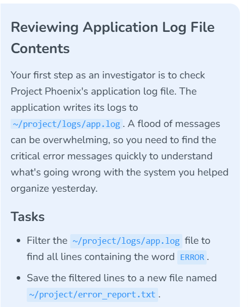
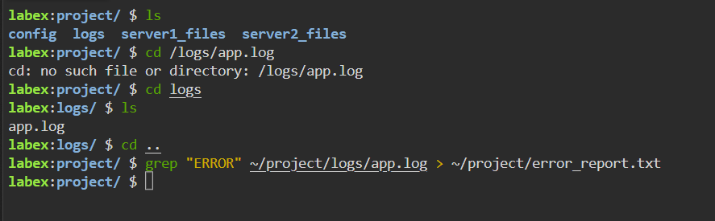
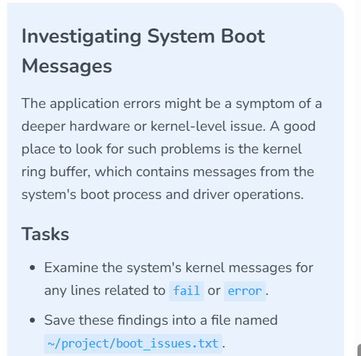
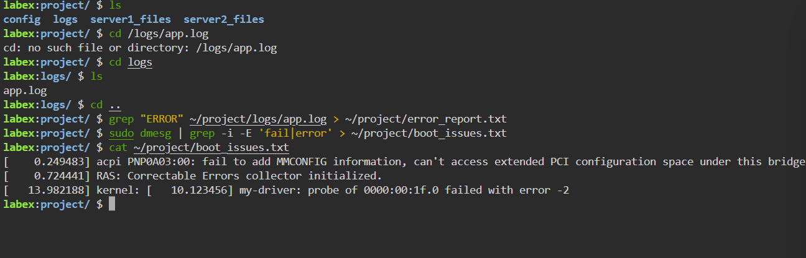
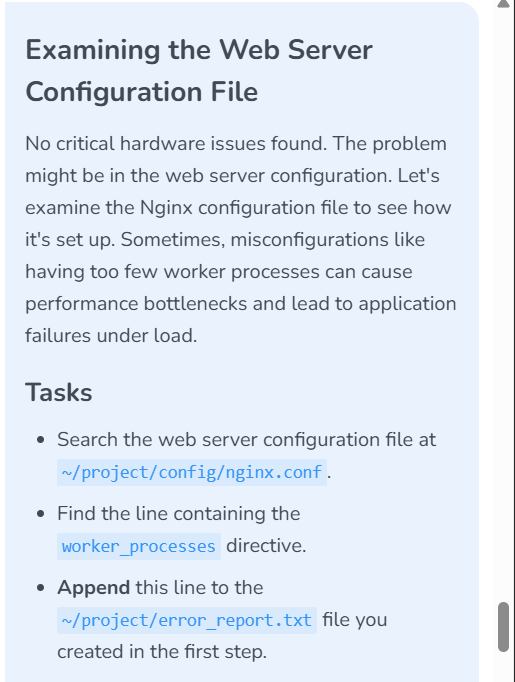
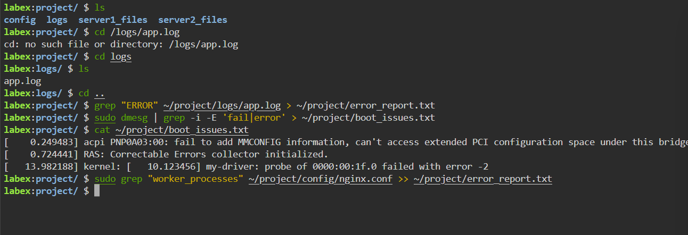
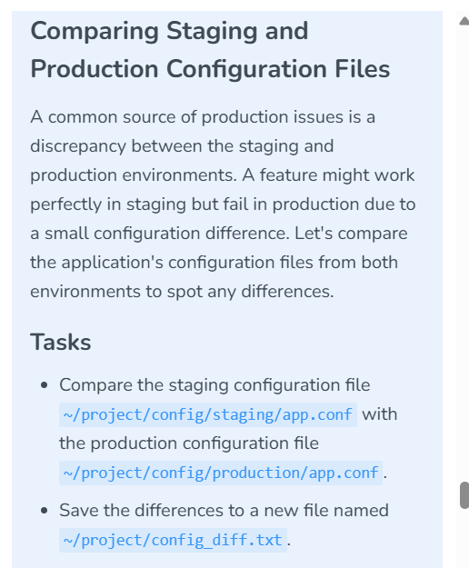
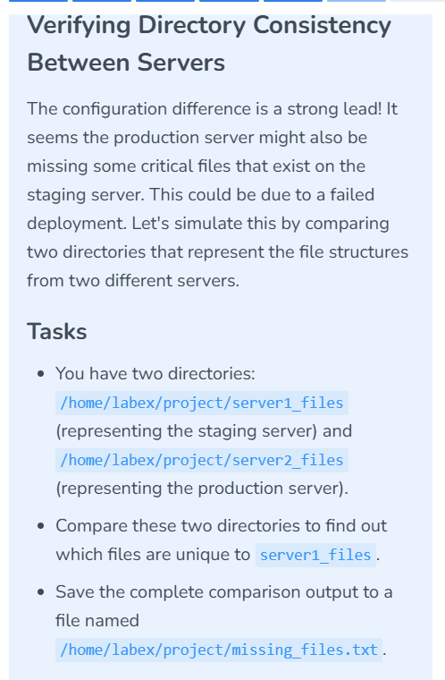

# Lab 004 — Application and Kernel Log Investigation

**Platform:** LabEx  
**Date:** October 17, 2026  
**Status:** Application filtering command evidenced; kernel report contents verified. Application report contents remain uninspected.

## Objective

Find lines containing `ERROR` in `~/project/logs/app.log` and save them to `~/project/error_report.txt`.

## Actions performed

I inspected the project directory, located `app.log` inside `logs`, returned to the project directory, and used `grep` with output redirection to create an error report.

```bash
ls
cd /logs/app.log
# cd: no such file or directory: /logs/app.log
cd logs
ls
cd ..
grep "ERROR" ~/project/logs/app.log > ~/project/error_report.txt
```

## Command interpretation

| Component | Purpose |
|---|---|
| `grep "ERROR"` | Select lines containing the case-sensitive text `ERROR` |
| `~/project/logs/app.log` | Input log path under the current user's home directory |
| `>` | Redirect standard output into a file, creating it or overwriting existing contents |
| `~/project/error_report.txt` | Destination report |

The search matches `ERROR` anywhere in a line; it does not enforce whole-word boundaries. No terminal output is expected for matching lines because standard output is redirected.

## Troubleshooting

My initial command used `/logs/app.log`, an absolute path starting at the filesystem root. The intended location is under `~/project/logs/`. Also, `cd` changes into directories, not log files. I corrected the navigation with `cd logs` and used `grep` to read the file.

## Evidence



*Figure 1: Application-log filtering requirement.*



*Figure 2: Corrected navigation and error-report command.*

The screenshot shows the filtering command returning to the prompt without a visible error. It does not show the report contents, number of matches, or command exit status. An empty report remains possible if no lines match.

## Verification to perform next

```bash
cat ~/project/error_report.txt
wc -l ~/project/error_report.txt
```

These checks are suggested, not yet evidenced. Review report contents before publishing logs that might contain sensitive information.

## Security relevance

Filtering logs reduces investigation noise and helps isolate application failures. An `ERROR` label alone does not establish malicious activity; assess timestamps, surrounding events, affected services, and other telemetry.

## Investigating kernel boot messages

I filtered the kernel ring buffer for case-insensitive matches to `fail` or `error`, saved the results, and displayed the report.

```bash
sudo dmesg | grep -i -E 'fail|error' > ~/project/boot_issues.txt
cat ~/project/boot_issues.txt
```

| Component | Meaning |
|---|---|
| `sudo dmesg` | Read kernel ring-buffer messages with elevated privileges |
| `\|` | Send the first command's standard output to the next command |
| `grep -i` | Match without case sensitivity |
| `-E 'fail\|error'` | Use extended regular expressions; match either alternative |
| `>` | Save matching lines to the report, overwriting any prior contents |
| `cat` | Display the saved report |

Three lines are visible in the report:

1. An ACPI message states that MMCFG information could not be added and extended PCI configuration space could not be accessed under a bridge.
2. `RAS: Correctable Errors collector initialized.`
3. A `my-driver` probe for `0000:00:1f.0` failed with `error -2`.

**Interpretation:** The RAS initialization line is a keyword match, not evidence by itself of a current failure. The ACPI and driver messages warrant investigation, but the screenshot does not establish their cause, severity, or connection to the application errors. Kernel output can include events after boot as well as boot-time messages.



*Figure 3: Kernel-message investigation requirement.*



*Figure 4: Saved kernel report inspected using cat.*

**Investigation lesson:** Keyword filtering produces candidates for review. Read surrounding messages and correlate symptoms before concluding that an application issue is caused by a kernel or hardware problem. No remediation or confirmed root cause is evidenced here.

## Examining Nginx configuration and appending evidence

I searched the lab's Nginx configuration for `worker_processes` and redirected the matching lines to the end of the existing error report.

```bash
sudo grep "worker_processes" ~/project/config/nginx.conf >> ~/project/error_report.txt
```

**Command interpretation:** `grep` selects lines containing the text `worker_processes`. The `>>` operator appends output, preserving existing report contents; `>` would overwrite them. The shell performs the redirection as the current user even though `grep` runs under `sudo`.

The terminal returns to the prompt without a visible error. Because output is redirected and the report is not displayed, the screenshot does not establish whether a line matched, the directive's configured value, or what was appended. A simple text search can also match commented lines.



*Figure 5: Configuration-review and report-append requirement.*



*Figure 6: Nginx configuration search and append command.*

**Verification to perform next (not yet evidenced):**

```bash
grep "worker_processes" ~/project/config/nginx.conf
tail -n 10 ~/project/error_report.txt
```

**Investigation limits:** The task narrative suggests investigating worker-process configuration. The screenshots do not establish that too few workers caused a bottleneck, that hardware faults have been ruled out, or that this lab configuration is the running server's active configuration. No configuration change, reload, or performance test has been demonstrated.

## Comparing staging and production configuration

I compared the two application configuration files, corrected an unnecessary pipeline, saved the differences, and displayed the saved report.

```bash
diff ~/project/config/staging/app.conf ~/project/config/production/app.conf
# An attempted "| grep > report" pipeline produced grep usage output.
sudo diff ~/project/config/staging/app.conf ~/project/config/production/app.conf > ~/project/config_diff.txt
cat ~/project/config_diff.txt
```

The report displays `1,5c1,5`: lines 1–5 of the first file differ from lines 1–5 of the second file.

| Setting | Staging | Production |
|---|---|---|
| Environment comment | Staging | Production |
| Database host | `staging-db` | `prod-db` |
| API key | Value omitted | Different value; omitted |
| `feature.flag.new_dashboard` | `true` | `false` |
| `timeout.ms` | `3000` | `5000` |

In normal `diff` output, `<` marks lines from the first file (staging), `>` marks lines from the second file (production), and `---` separates the two blocks. The saved report contents are evidenced by the subsequent `cat` output.

**Troubleshooting:** `grep` requires a pattern. Piping to bare `grep` caused the usage error; adding `sudo` did not fix the syntax. Direct output redirection from `diff` resolved the reporting task. When readable files are compared, elevated privileges are unnecessary.



*Figure 7: Configuration comparison and report requirement.*

**Evidence handling:** The terminal screenshot contains API-key values and is excluded from the public repository. The table above records the relevant differences without reproducing keys.

**Interpretation:** Environment-specific database endpoints and keys may be intentional. The feature flag and timeout differ, but the comparison alone does not prove which setting caused the application issue. No configuration change or root-cause validation is evidenced.

**Command behavior:** `diff` normally returns `0` for identical files, `1` for differences, and a value greater than `1` for an error. Differences are an expected result of a comparison.

## Comparing simulated server directory trees

I compared `server1_files` (staging) and `server2_files` (production) recursively and redirected the complete comparison output into a report.

```bash
diff -r ~/project/server1_files ~/project/server2_files > ~/project/missing_files.txt
```

The `-r` option makes `diff` descend into subdirectories. It can report files present in only one tree and content differences between corresponding files. The command preserves the full comparison output rather than filtering it.

The screenshot shows the command returning to the prompt without a visible error. The report has not yet been displayed, so no particular missing file, directory difference, or failed deployment is established by this evidence.



*Figure 8: Recursive directory comparison and report requirement.*

**Evidence handling:** The accompanying terminal screenshot includes API-key values from the previous configuration comparison and is excluded from the public repository. The directory comparison command is transcribed above without those values.

**Verification to perform next (not yet evidenced):**

```bash
cat ~/project/missing_files.txt
```

Lines beginning `Only in` identify entries unique to the named directory. Entries unique to `server1_files` are candidates for files absent from the simulated production tree. Review the entire report before deciding whether differences are expected or indicate a deployment problem.

**Lesson learned:** Recursive flags are command-specific: `diff -r` compares directory trees and `cp -r` copies them; `mv` does not require a recursive flag.

[← Linux portfolio index](../../README.md)
